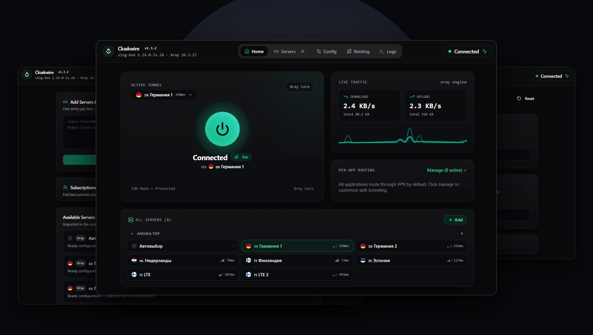

<div align="center">


# Cloakwire

**Кроссплатформенный VPN-клиент для десктопа и мобильных устройств на базе ядер sing-box и Xray.**

Windows · macOS · Android · Rust/Tauri & React · VLESS Reality · Hysteria 2 · TUIC · Без телеметрии · Открытый исходный код

<br/>

[](https://github.com/markwhite7881-cpu/cloakwire/releases/latest)
[](https://github.com/markwhite7881-cpu/cloakwire/releases/latest)
[](https://github.com/markwhite7881-cpu/cloakwire/releases/latest)
[](LICENSE)

<br/>

**[ 🇬🇧 English ](README.md)** &nbsp;|&nbsp; **[ 🇷🇺 Русский ](README.ru.md)** &nbsp;|&nbsp; **[ 🇨🇳 简体中文 ](README.zh-CN.md)**

<br/>



</div>

---

## ⚡ Загрузка релизов (v1.4.9)

| Платформа | Установщик | Альтернатива | Архитектура |
|---|---|---|---|
| **Windows** | [Скачать .exe](https://github.com/markwhite7881-cpu/cloakwire/releases/download/v1.4.9/Cloakwire_1.4.9_x64-setup.exe) | [Скачать .msi](https://github.com/markwhite7881-cpu/cloakwire/releases/download/v1.4.9/Cloakwire_1.4.9_x64_en-US.msi) | x64 (Intel / AMD) |
| **macOS Apple Silicon** | [Скачать .dmg](https://github.com/markwhite7881-cpu/cloakwire/releases/download/v1.4.9/Cloakwire_1.4.9_aarch64.dmg) | [Скачать .app.zip](https://github.com/markwhite7881-cpu/cloakwire/releases/download/v1.4.9/Cloakwire_1.4.9_aarch64.app.zip) | arm64 (Apple Silicon) |
| **macOS Intel** | [Скачать .dmg](https://github.com/markwhite7881-cpu/cloakwire/releases/download/v1.4.9/Cloakwire_1.4.9_x64.dmg) | [Скачать .app.zip](https://github.com/markwhite7881-cpu/cloakwire/releases/download/v1.4.9/Cloakwire_1.4.9_x64.app.zip) | x86_64 |
| **Android** | [Скачать .apk](https://github.com/markwhite7881-cpu/cloakwire/releases/download/v1.4.9/Cloakwire_1.4.9_arm64-v8a.apk) | — | arm64-v8a · Android 7.0+ |

> 🔒 Все семь пакетов релиза, включая Android, имеют подписи **Minisign** `.sig`. Контрольные суммы SHA-256 опубликованы в [`SHA256SUMS.txt`](https://github.com/markwhite7881-cpu/cloakwire/releases/download/v1.4.9/SHA256SUMS.txt).

## 🚀 Что нового в 1.4.9

- Готовые профили подписок проверяются своим ядром перед подключением на Windows, macOS и Android.
- При ошибке профиля показываются понятная причина, дальнейшие действия и отчёт для копирования без конфигурации провайдера.
- Некорректный профиль отклоняется до замены активного подключения; отмена проверки не запускает VPN.
- Проверки выпуска охватывают все пакеты, подписи обновлений, контрольные суммы и базы GeoIP для Android.
- Интерфейс Windows, macOS и Android и диагностические отчёты используют синхронизированную версию приложения.

[Полная история изменений](CHANGELOG.md) · [v1.4.9](https://github.com/markwhite7881-cpu/cloakwire/releases/tag/v1.4.9)

## Быстрый старт

Cloakwire — клиент. Для подключения нужен собственный сервер или подписка провайдера.

1. Скачайте и установите пакет для своей операционной системы из таблицы выше.
2. Добавьте сервер или подписку. Поддерживаются ссылки на подключения, списки ссылок в Base64, подписки Clash и готовые профили sing-box/Xray.
3. Выберите сервер или профиль и подключитесь. Готовый профиль проверяется до замены активного соединения; при ошибке следуйте подсказкам карточки.

## 🌟 Ключевые возможности

### Два ядра и подписки

- **sing-box** используется по умолчанию; **Xray** работает с совместимыми профилями Xray.
- Готовая конфигурация запускается своим ядром. Ошибки проверки отображаются перед подключением.
- Импорт отдельных ссылок, управление подписками и обновление профилей провайдера.

### Маршрутизация и режимы подключения

- TUN и системный прокси на десктопе; правила по приложениям, доменам и IP, включая GeoIP / Bypass RU.
- Готовые профили sing-box сохраняют настройки DNS и правила провайдера при применении локальных правил GeoIP / Bypass RU.
- Выбранные приложения можно направлять через VPN или напрямую. Возможности зависят от платформы и ядра; для неподдерживаемых правил Xray по приложениям показывается предупреждение.
- На macOS для TUN запрашиваются права администратора, когда они необходимы. Подготовленный бинарник может использовать выданные права; после его замены подтверждение может потребоваться снова.

### Десктоп и Android

- Системный трей, быстрые команды подключения, таймер сессии и статистика трафика на десктопе.
- VPN-служба Android, виджеты рабочего стола со статусом подключения и импорт из буфера обмена.
- Встроенная проверка скорости и уведомления о подключении на десктопе.

### Оформление и языки

- Системная, светлая, тёмная и OLED-темы; акценты Emerald, Cyan, Violet, Amber и Rose.
- Русский, английский и упрощённый китайский; язык переключается в настройках.

## 🛡️ Приватность и проверка релиза

- Нет встроенной телеметрии, аналитики и автоматической отправки отчётов о падениях.
- Профили, подписки и учётные данные обрабатываются и хранятся в локальном каталоге данных приложения.
- Работа DNS зависит от выбранных настроек и профиля провайдера. В готовых профилях сохраняется DNS-конфигурация провайдера.
- Механизм обновления проверяет подписи файлов публичным ключом, встроенным в приложение.

Minisign защищает загрузки механизма обновления. Windows-пакеты распространяются без подписи Authenticode; приложения macOS имеют подпись ad hoc и не проходят нотариализацию Apple. Поэтому ОС может показывать предупреждения безопасности. Перед установкой сверьте файл с опубликованными контрольными суммами.

Пример: проверьте установщик Windows и сравните результат с `SHA256SUMS.txt`:

```powershell
(Get-FileHash Cloakwire_1.4.9_x64-setup.exe -Algorithm SHA256).Hash.ToLowerInvariant()
```

## 🔧 Форматы ссылок на подключения

| Протокол | Схемы ссылок | Совместимое ядро |
|---|---|---|
| VLESS | `vless://` | sing-box / Xray |
| VMess | `vmess://` | sing-box / Xray |
| Trojan | `trojan://` | sing-box / Xray |
| Shadowsocks | `ss://` | sing-box / Xray |
| Hysteria 2 | `hy2://` / `hysteria2://` | sing-box |
| TUIC | `tuic://` | sing-box |

Поддержка транспортов и правил зависит от ядра и профиля. Готовые профили проверяются в собственном формате ядра перед подключением.

## 🛠️ Сборка из исходников

### Инструменты

- Node.js и npm; релиз 1.4.9 собран с Node.js 24 на Windows и 22 на macOS.
- Rust stable с установленным целевым target для нужной платформы.
- Windows: Visual Studio C++ Build Tools и среда WebView2; Tauri упаковывает установщики с помощью NSIS/WiX.
- macOS: Xcode Command Line Tools; для обеих архитектур установите Rust targets `aarch64-apple-darwin` и `x86_64-apple-darwin`.
- Android: JDK 17, Android SDK platform 36 и build-tools, NDK `28.0.13004108`, Rust target `aarch64-linux-android`. Используйте Gradle wrapper из репозитория.

### Бинарные зависимости

Чистый клон репозитория не содержит крупных бинарников ядер, библиотек Android и геоданных. Подготовьте их перед сборкой нативного приложения:

- `src-tauri/binaries/`: исполняемые файлы `sing-box` и `xray` с суффиксом целевой платформы; текущая конфигурация упаковки также требует `wintun.dll`.
- Android: `app/libs/libbox.aar` и файлы `app/src/main/jniLibs/arm64-v8a/libxray.so`, `libhev-socks5-tunnel.so` внутри `src-tauri/gen/android/`.
- Android: `geoip.dat` и `geosite.dat` в `src-tauri/gen/android/app/src/main/assets/`. Rust-библиотека компилируется из исходников сценарием выпуска.

Подготовка ядер описана в [сценарии Xray](scripts/prepare-xray-sidecar.ps1), [workflow Android](.github/workflows/release-android.yml) и [workflow macOS](.github/workflows/release-macos.yml).

Файл `src-tauri/.cargo/config.toml` содержит пути конкретной Windows-машины. Настройте или переопределите их для своего окружения; сценарий полного выпуска берёт пути из локальной конфигурации и удаляет Windows-конфигурацию Cargo на Mac-хосте сборки.

### Проверка интерфейса

Эти команды проверяют и собирают интерфейс без компиляции нативного приложения:

```bash
git clone https://github.com/markwhite7881-cpu/cloakwire.git
cd cloakwire
npm ci
npm test
npm run build
```

После подготовки инструментов и бинарных зависимостей используйте `npm run tauri:dev` для разработки десктопного приложения и `npm run tauri:build` для его релизной сборки.

### Полный выпуск для всех платформ

Полный сценарий запускается на Windows и собирает macOS удалённо по SSH. Скопируйте `scripts/release.local.example.psd1` в исключённый из Git файл `release.local.psd1`, укажите пути инструментов, ядер, ключей подписи и Mac-хоста. Путь `BuildRoot` должен содержать только ASCII-символы; приватные ключи и пароли храните вне Git.

Основная версия хранится в `src-tauri/tauri.conf.json`. Перед коммитом нового выпуска синхронизируйте метаданные пакетов, Rust и Android командой `npm run release:version -- set <version>`.

Соберите отдельную утилиту подписи и укажите в `SignerPath` путь `.release-work/tools/release/tauri-signer.exe`:

```powershell
cargo build --release --manifest-path src-tauri/crates/tauri-signer/Cargo.toml --target-dir .release-work/tools
```

```powershell
Copy-Item scripts/release.local.example.psd1 release.local.psd1
# Настройте пути в release.local.psd1 перед продолжением.
npm run release:check
npm run release:test
npm run release:build -- -CheckOnly
npm run release:build
```

Перед `release:build` закоммитьте проверенные исходники и описание версии: все платформы собираются из одного чистого архива HEAD. Каждый запуск использует отдельные каталоги исходников, компиляции, установщиков и журналов. Семь пакетов подписываются и проверяются; публикация сначала создаёт черновик и сверяет хеши всех 18 загруженных файлов. Команда `npm run release:publish -- -DistPath <artifacts> -Publish` явно публикует проверенный черновик после отправки соответствующего Git-тега.

[Подробная инструкция выпуска](docs/RELEASE_WORKFLOW.md)

## 📄 Лицензия

Исходный код приложения Cloakwire распространяется под лицензией **MIT**; см. [LICENSE](LICENSE). Встроенные ядра и сторонние библиотеки сохраняют собственные лицензии.
